# 給硬體團隊：四層驗證的使用說明

版本：2026-11-23（第 2 版）・對象：負責 RTL 模擬或 FPGA 驗證的人

這份文件說明 `conformance\` 資料夾裡的測試是什麼、怎麼執行、要回報什麼。
它假設你熟悉自己的 RTL 與測試平台，但**不假設你用過我們的組譯器或模擬器**，所以需要的背景都寫在第 2 章。

**怎麼讀這份文件**

| 你想做的事 | 讀這幾章 |
|---|---|
| 先了解這是什麼、要花多少工夫 | 第 1 章 |
| 動手跑第一支測試 | 第 2、4、5、6 章 |
| 已經跑通第一支，要做其餘的 | 第 7 章起，各層一章 |
| 測試結果和預期不同 | 第 13 章 |
| 查名詞 | 第 14 章 |

---

## 1. 這件事是什麼

### 1.1 現況

軟體這一側有三個工具：

- **組譯器**（`asmc`）：把組合語言原始碼變成要放進硬體的位元組（稱為映像）。
- **模擬器**（`asmsim`）：在電腦上執行同一份映像，預測硬體會做什麼。
- **反組譯器**（`asmdis`）：把位元組轉回文字，用來檢查。

這三個工具彼此一致，也符合我們對規格書的理解。但**到目前為止沒有任何一項對照過 RTL 或實體硬體**。
規格書沒有寫明的地方——例如 ALU 各運算的編碼數值、每道指令花幾個週期——工具裡用的是暫定值。

所以有兩件事現在還不知道：

1. 工具產生的映像放進硬體，硬體解出來的是不是我們以為的那些指令。
2. 模擬器預測的行為與時間，和硬體是不是一樣。

只有硬體能回答。這套測試就是把問題拆成可以逐一回答的小題。

### 1.2 整體流程

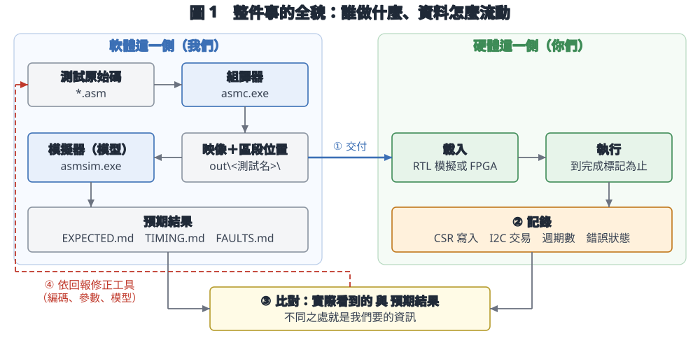

圖 1 的四個步驟：

1. **交付**：我們提供已經組譯好的映像，以及每一份映像的預期結果。
2. **記錄**：你們把映像載入 RTL 模擬（或 FPGA），執行，記錄 CSR 匯流排上的寫入。
3. **比對**：把記錄和預期結果比較。可以由你們比，也可以把記錄整份給我們。
4. **修正**：我們依回報修正工具裡的暫定值，直到兩邊一致。

重點在第 3 步：**結果不同並不代表誰做錯了**。多數的差異只是「規格沒寫、我們猜的值和硬體不同」，
這正是要找出來的資訊。請照實回報看到的現象就好，不需要先判斷原因。

### 1.3 四層各回答什麼

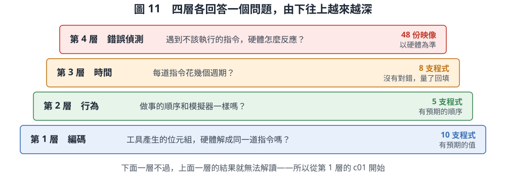

| 層 | 要回答的問題 | 數量 | 結果的性質 |
|---|---|---|---|
| 1 編碼 | 工具產生的位元組，硬體解成同一道指令嗎？ | 10 支程式 | 有確定的預期值 |
| 2 行為 | 做事的先後順序和模擬器一樣嗎？ | 5 支程式 | 有預期的順序與 I2C 交易 |
| 3 時間 | 每道指令花幾個週期？ | 8 支程式 | 沒有對錯，量了回填 |
| 4 錯誤偵測 | 遇到不該執行的指令，硬體怎麼反應？ | 48 份映像 | 以硬體為準 |

各層需要的準備不同，第 7 章有建議的順序。**不必四層都做完才回報**：每完成一支就可以把結果給我們。

### 1.4 大概要花多少工夫

| 工作 | 內容 | 只需要做一次嗎 |
|---|---|---|
| 讓測試平台能載入我們的映像 | 第 5 章 | 是 |
| 把 CSR 寫入記錄成檔案 | 第 4 章 | 是 |
| 跑通第一支（`c01`） | 第 6 章 | 是；跑通之後其餘測試只是換檔案 |
| I2C 裝置模型 | 第 4.3 節，六個位址 | 是；只有部分測試需要 |
| 填板子的 CSR 位址 | 第 4.5 節 | 是；只有四支測試需要 |

最花時間的是前三項。它們完成之後，其餘六十多份映像都是重複同樣的動作。

---

## 2. 需要先知道的背景

這一章說明我們對硬體的理解，以及測試用到的幾個概念。
**如果這裡的描述和你們的 RTL 不同，請直接告訴我們**——那本身就是重要的回報。

### 2.1 架構

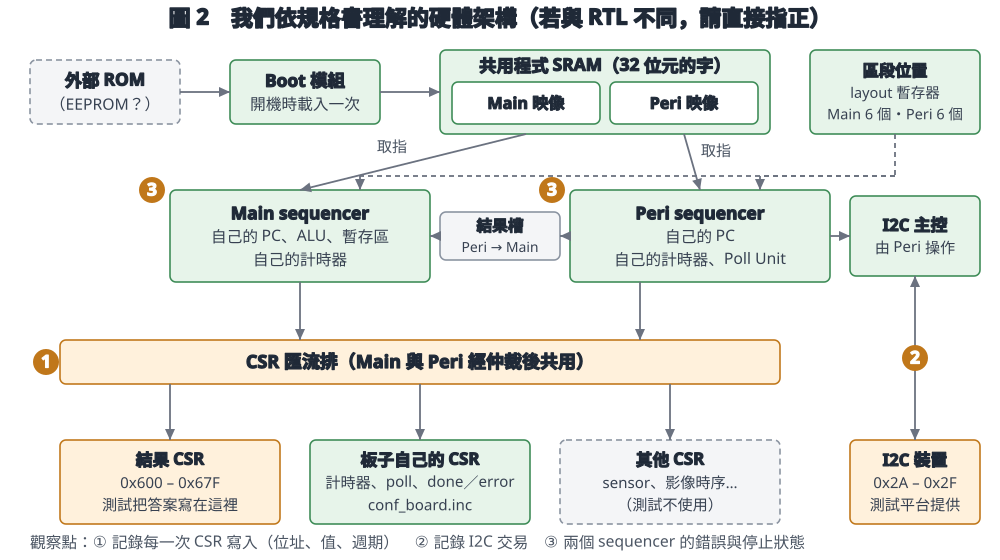

圖 2 是我們依規格書（v31）畫的。幾個要點：

- **兩個 sequencer**：Main 與 Peri。它們各有自己的程式、自己的 PC、自己的計時器，同時執行。
- **程式放在共用的 SRAM**：一顆 32 位元字的 SRAM，Main 與 Peri 的映像各佔一段，不共用任何一個字。
- **區段位置（layout）另外存放**：每個 sequencer 有六個位移值，告訴硬體映像裡各張表從哪裡開始。它們不在映像裡。
- **CSR 匯流排**：兩個 sequencer 都能讀寫 CSR，經仲裁後共用一條匯流排。
- **I2C**：只有 Peri 能發出 I2C 交易。
- **結果槽**：Peri 把讀到的資料發佈給 Main 的管道。

圖上的三個數字是測試平台的觀察點：① CSR 寫入、② I2C 交易、③ 兩個 sequencer 的錯誤與停止狀態。

圖中「外部 ROM」畫成虛線，因為我們不確定它是什麼元件、執行時是否還會用到（第 12.2 節的問題 1、2）。

### 2.2 一道指令的構造

每道指令的第一個位元組分成兩部分：高 2 位元是 opcode，低 6 位元是 arg。
arg 通常不是運算元本身，而是**描述子表的索引**——真正的內容（CSR 位址、分支目標、運算種類…）放在描述子表裡。

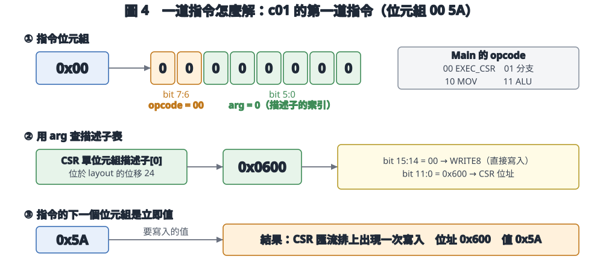

圖 4 是第一支測試 `c01` 的第一道指令 `00 5A`：

1. 指令位元組 `0x00`：opcode＝`00`（EXEC_CSR），arg＝0。
2. 用 arg 去查「CSR 單位元組描述子表」的第 0 筆，得到 `0x0600`：寫入的方式是 WRITE8，CSR 位址是 `0x600`。
3. 指令的第二個位元組 `0x5A` 是要寫入的值。

結果是 CSR 匯流排上出現一次寫入：位址 `0x600`、值 `0x5A`。

這說明了第 1 層在檢查什麼：**指令位元組的切分、描述子的欄位位置、描述子的位元組序、表格的位置**，
任何一項兩邊理解不同，匯流排上出現的位址或值就會不一樣。

Main 的四個 opcode：`00` EXEC_CSR、`01` 分支、`10` MOV、`11` ALU。Peri 的 opcode 是另一組（CSR、分支、發佈結果、I2C 傳輸）。

### 2.3 映像與區段位置

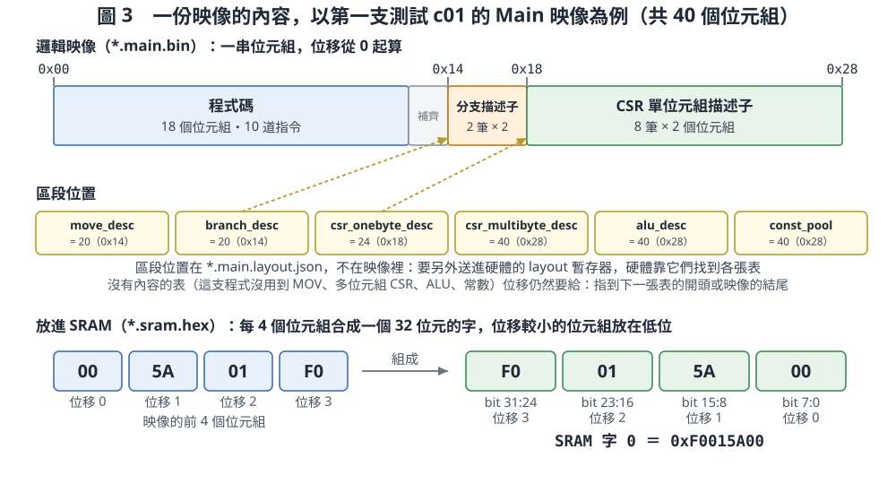

圖 3 是 `c01` 的 Main 映像，共 40 個位元組。由上到下三件事：

**邏輯映像**是一串位元組：前面是程式碼，後面依序是各張描述子表。位移從 0 起算。
這就是 `*.main.bin` 的內容。

**區段位置**是六個數字，說明每張表從第幾個位元組開始。它們存在 `*.main.layout.json`，不在映像裡。
硬體需要這六個數字才找得到表。`c01` 的六個值是 20、20、24、40、40、40。
沒有內容的表也有位移（指到下一張表的開頭或映像的結尾）。

**放進 SRAM** 時每 4 個位元組合成一個 32 位元的字，位移較小的位元組在低位。
`c01` 的前四個位元組 `00 5A 01 F0` 成為字 0＝`0xF0015A00`。

Peri 的映像結構相同，只是表的種類不同（也是六個位移），放在 SRAM 的另一段。

### 2.4 測試怎麼「回答」

硬體內部的狀態不容易從外面看到，所以每支測試都**把答案寫到一段 CSR**，測試平台只要記錄匯流排上的寫入：

| 名稱 | 位址 | 用途 |
|---|---|---|
| `RES+0` … `RES+126` | `0x600` – `0x67E` | 結果：每支測試把算出的值、或執行到某處的記號寫在這裡 |
| 完成標記（`RES_DONE`） | `0x67F` | 每支測試最後寫入 `0xA5`，表示跑到結尾了 |

這一段稱為**結果 CSR**。測試只需要「匯流排上看得到對這些位址的寫入」，那些位址不必真的有暫存器
（少數幾格例外，見第 4.2 節）。位址可以換（第 4.4 節）。

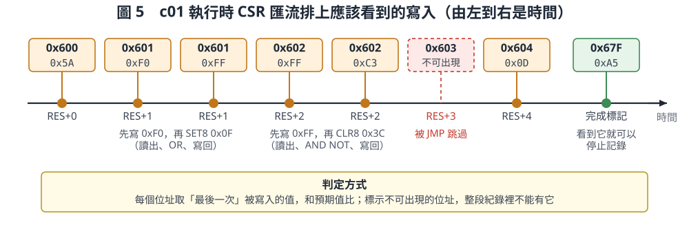

圖 5 是 `c01` 應該出現的寫入。判定的規則只有兩條：

- 每個位址取**最後的內容**，和預期值比。
- 標示「不可被寫入」的位址，整段記錄裡不能出現。圖中的 `0x603` 是一道被跳躍略過的寫入：它出現就表示分支沒有跳到目標。

關於圖中 `0x601` 的第二次寫入：那是 SET8（把某些位元設為 1）。我們預期的是**暫存器最後的內容**為 `0xFF`。
你們的匯流排上它可能是一次「讀出、合併、寫回 `0xFF`」，也可能是別的形式——請以暫存器最後的內容為準，
並告訴我們 SET8／CLR8 在匯流排上實際長什麼樣子。

---

## 3. 你們會拿到什麼

整個 `dist\msvc2026\` 資料夾。

```
dist\msvc2026\
  asmc.exe  asmsim.exe  asmdis.exe      組譯器、模擬器、反組譯器
  docs\                                 相關的說明文件
  conformance\
    HW_TEAM_GUIDE.md / .pdf             本文件
    EXPECTED.md                         第 1、2 層的預期結果
    TIMING.md                           第 3 層的量測項目與預測值
    FAULTS.md                           第 4 層各映像的內容
    conf_defs.inc                       結果 CSR 的位址
    conf_board.inc                      板子自己的 CSR（目前是範例值）
    *.asm                               各測試的原始碼
    *.csv                               表格與回報用的範本
    make_*.py                           產生器（需要 Python 3）
    out\<測試名>\                        已經產生好的映像
```

測試名稱的第一個字母代表層別：

| 開頭 | 層 | 例 |
|---|---|---|
| `c` | 第 1 層 編碼 | `c01_csr_branch` |
| `b` | 第 2 層 行為 | `b01_timers` |
| `t` | 第 3 層 時間 | `t01_alu` |
| `f_` | 第 4 層 錯誤偵測 | `f_b1` |

`out\` 裡的映像**已經產生好，可以直接使用**。只有在要換結果 CSR 的位址、或填好板子的 CSR 之後，才需要重新產生。

---

## 4. 準備測試平台

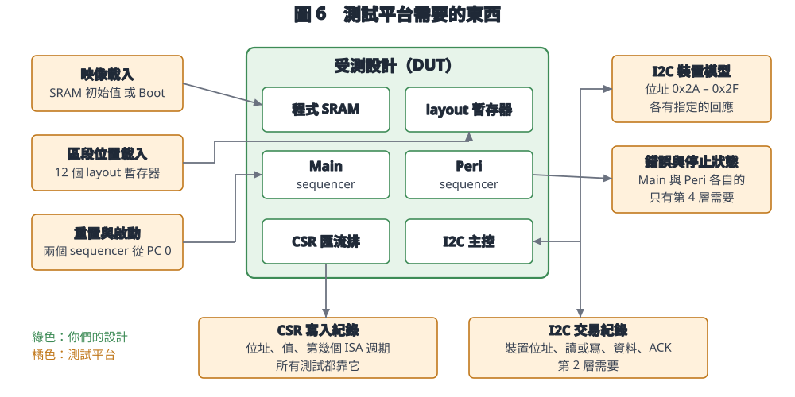

圖 6 中綠色是你們的設計，橘色是測試平台要提供的東西。以下逐項說明。

### 4.1 一定要有的：CSR 寫入記錄

所有測試都靠它。請在 CSR 匯流排上記錄每一次寫入，每筆三個欄位：

| 欄位 | 說明 |
|---|---|
| 位址 | 被寫入的 CSR 位址 |
| 值 | 寫入的資料 |
| 週期 | 這次寫入發生在第幾個 ISA 週期（第 1、2、4 層只需要先後順序；第 3 層才需要數字） |

如果能分辨是 Main 還是 Peri 發出的，請多記一欄，除錯時很有幫助。

格式不拘。CSV 最方便，例如：

```
cycle,source,addr,data
12,main,0x600,0x5A
15,main,0x601,0xF0
```

記錄**所有**位址的寫入，不要只記 `0x600`–`0x67F`：測試也會寫其他 CSR（例如計時器），
那些寫入對除錯有用。

### 4.2 幾個位址需要「寫什麼讀回什麼」

大部分結果 CSR 只被寫入，不需要有實體的暫存器。但有三支測試會把結果 CSR 讀回來：

| 測試 | 用到讀回的地方 |
|---|---|
| `c01` | `RES+1`、`RES+2`：SET8／CLR8 要先讀出原值 |
| `c09` | 測的就是 CSR 讀取 |
| `t04` | 量 CSR 讀取花的時間 |

最簡單的做法是讓 `0x600`–`0x67F` 整段成為一般的讀寫暫存器。
做不到的話，這三支裡標示了這個前提的格子先略過，其餘照常。

### 4.3 I2C 裝置模型

只有部分測試需要。每個位址是一個簡單的暫存器式裝置（先寫暫存器位址，再讀或寫資料）。位址是 7 位元。

| 位址 | 行為 | 用到的測試 |
|---|---|---|
| `0x2A` | 暫存器 `0x10` 讀到 `0xC3`；`0x20`–`0x23` 依序讀到 `D0 D1 D2 D3`；寫入 `0x30` 回 ACK | `c10` |
| `0x2B` | 暫存器 `0x05` 前兩次讀到 `0x00`，第三次起讀到 `0x01`；`0x40`、`0x41` 讀到 `E0`、`E1` | `b02`、`b05` |
| `0x2C` | 暫存器 `0x01` 讀到 `0xA1`；`0x02` 讀到 `0xA2` | `b03` |
| `0x2D` | **不可以有裝置**：測的是沒有人回應 | `b04`、`b05` |
| `0x2E` | 任何讀寫都回 ACK，讀到的值不拘 | `t06` |
| `0x2F` | 任何讀寫都回 ACK，讀到的值不拘 | 第 4 層 X 開頭的案例 |

`0x2B` 的「前兩次讀到 0、第三次起讀到 1」模擬一個過一會兒才就緒的裝置，用來測輪詢。

第 2 層還需要記錄 I2C 匯流排上的交易（裝置位址、讀或寫、資料、有沒有 ACK）。

**沒有 I2C 裝置模型時，以下測試仍然可以跑**：`c01`–`c09`、`b01`、`t01`–`t05`、`t07`、`t08`，以及第 4 層 X 以外的 42 個案例。

### 4.4 結果 CSR 換位址

如果 `0x600`–`0x67F` 在你們的設計裡是**有作用的暫存器**（寫了會發生事情），請換一段沒有作用的位址，然後重新產生映像：

```
cd dist\msvc2026\conformance
python make_conformance.py --bin-dir .. --res-base 0x700
python make_timing.py      --bin-dir .. --res-base 0x700
python make_faults.py      --bin-dir .. --res-base 0x700
```

三行分別重新產生第 1–2 層、第 3 層、第 4 層。完成後 `out\` 與三份說明文件（EXPECTED、TIMING、FAULTS）裡的位址都會跟著變。
需要 128 個連續的位址。

### 4.5 板子自己的 CSR

`b01`、`b02`、`b05`、`t07` 這四支會操作計時器、輪詢單元、done／error 旗標。
規格書只給了這些暫存器的名稱，沒有位址與位元，所以 `conf_board.inc` 裡目前是**我們編的範例值**：

| 名稱 | 範例位址 | 用途 |
|---|---|---|
| `POLL_MASK` | `0x300` | 狀態位元組裡哪些位元代表 ready |
| `POLL_CTRL` | `0x301` | 寫 1：bit 0 清除 poll 旗標，bit 1 arm |
| `PERI_CTRL` | `0x302` | 寫 1：bit 0 設 done，bit 1 設 error，bit 2 清除旗標，bit 3 啟動 Peri 計時器 |
| `PERI_TPER`、`PERI_TPER_H` | `0x310`、`0x311` | Peri 計時器的週期（tick），低、高位元組 |
| `MAIN_TPER`、`MAIN_TPER_H` | `0x320`、`0x321` | Main 計時器的週期（tick），低、高位元組 |
| `MAIN_CTRL` | `0x322` | 寫 1：bit 0 啟動 Main 計時器 |

**做法**：

1. 用文字編輯器開啟 `conf_board.inc`，把位址與位元改成你們實際的值。
2. 執行第 4.4 節的三行指令重新產生（不換位址時省略 `--res-base`）。
3. 把改好的 `conf_board.inc` 連同結果一起給我們。

你們改過的 `conf_board.inc` 不會被產生器覆寫。

**如果介面本身不同**——例如計時器的週期不是兩個位元組、啟動的方式不是寫 1、done 與 error 在不同的暫存器——
光改位址不夠，測試程式也要改。這種情況請直接告訴我們實際的介面，由我們改程式再交給你們。

### 4.6 準備好了嗎：檢查表

| 項目 | 需要它的測試 |
|---|---|
| 能把映像放進程式 SRAM | 全部 |
| 能把 12 個區段位置送進硬體 | 全部 |
| 能記錄 CSR 寫入（位址、值、先後） | 全部 |
| CSR 寫入帶有週期數 | 第 3 層 |
| `0x600`–`0x67F` 可讀回 | `c01` 的兩格、`c09`、`t04` |
| I2C 裝置模型與交易記錄 | `c10`、`b02`–`b05`、`t06`、第 4 層 X |
| `conf_board.inc` 已填入實際值 | `b01`、`b02`、`b05`、`t07` |
| 看得到 sequencer 的錯誤與停止狀態 | 第 4 層 |

前三項具備就可以開始。

---

## 5. 載入映像

### 5.1 每個測試資料夾裡的檔案

`out\<測試名>\` 下是同一支程式的幾種格式。**挑你們的測試平台用得上的那一種**，不需要全部都用。

| 檔案 | 內容 |
|---|---|
| `*.sram.hex` | 程式 SRAM 的內容，Main 與 Peri 都在裡面，已擺在各自的位置 |
| `*.boot.json` | 開機載入計畫：SRAM 每個字的值、12 個區段位置的值、步驟順序 |
| `*.main.bin`、`*.peri.bin` | 邏輯映像的原始位元組 |
| `*.main.hex`、`*.peri.hex` | 同上，Intel HEX 格式 |
| `*.main.layout.json`、`*.peri.layout.json` | 六個區段位置 |
| `*.eeprom.bin`、`*.eeprom.hex` | I2C EEPROM 的內容 |
| `*.eeprom.json` | EEPROM 裡六個區域各自的位址 |
| `*.lst` | 清單：每道指令的位址與位元組，每筆描述子解讀後的意思 |

只有 Main 程式的測試沒有 `peri` 的檔案（Peri 那一段 SRAM 留空，Peri 不需要啟動）。`b04` 只有 Peri。

### 5.2 做法甲：直接設定 SRAM 的初始值（建議）

RTL 模擬時最簡單。需要兩樣東西：

**（一）SRAM 的內容**——`*.sram.hex`。每行是「字位址、32 位元資料」，`//` 之後是註解：

```
0000 F0015A00 // Main
0001 FF030F02 // Main
0002 05403C04 // Main
0003 070D06BD // Main
0004 000041A5 // Main
```

位址是十六進位的字位址（不是位元組位址）。Main 從字 0 開始，Peri 從字 `0x0200`（512）開始。
格式接近 Verilog 的 `$readmemh`，但位址前面沒有 `@`，使用前可能要轉換。
檔案沒有列出的字不會被用到，內容不拘。

**（二）區段位置**——`*.main.layout.json` 與 `*.peri.layout.json` 裡 `fields` 那一段：

```
"fields":{
  "main_move_desc_offset":20,
  "main_branch_desc_offset":20,
  "main_csr_onebyte_desc_offset":24,
  "main_csr_multibyte_desc_offset":40,
  "main_alu_desc_offset":40,
  "main_const_pool_offset":40
}
```

這六個數字是**位元組位移**（不是字位址），要送進硬體對應的六個 layout 暫存器。Peri 也有六個：
`peri_xfer_onebyte_desc_offset`、`peri_xfer_multibyte_desc_offset`、`peri_publish_desc_offset`、
`peri_branch_desc_offset`、`peri_csr_onebyte_desc_offset`、`device_map_offset`。

`*.boot.json` 的 `sideband_writes` 把這 12 個值列成一張表，寫測試平台的腳本時用它比較方便。

**（三）啟動**：解除重置，兩個 sequencer 都從 PC 0 開始。

### 5.3 做法乙：經過 Boot 模組

如果要連 Boot 一起測，`*.boot.json` 的 `sequence` 列出我們預期的步驟：

1. 讓兩個 sequencer 保持在重置。
2. 把 `sram_writes` 表裡每個字寫進共用的 SRAM。
3. 把 `sideband_writes` 表裡的 12 個區段位置送進 layout 暫存器。
4. 宣告映像有效，鎖住 SRAM 的寫入路徑。
5. 解除重置，兩個 sequencer 都從 PC 0 開始。

Boot 的資料來源（外部 ROM）用什麼格式，我們不知道。如果是 I2C EEPROM，可以用 `*.eeprom.bin`；
它裡面各區域的位址在 `*.eeprom.json`。

### 5.4 做法丙：執行時從 EEPROM 取指

如果你們的設計在執行時每道指令都從 I2C EEPROM 讀出（而不是從 SRAM），請用 `*.eeprom.bin` 作為 EEPROM 模型的內容，
裝置位址是 `0x50`，位址寬度 2 個位元組。六個區域的起始位址在 `*.eeprom.json` 的 `regions`。

### 5.5 請告訴我們你們用哪一種

甲、乙、丙哪一種符合你們的設計，本身就是我們想知道的事（第 12.2 節的問題 1、2）。
三種格式的內容是同一支程式，我們核對過它們逐位元組一致。

---

## 6. 跑第一支測試：c01 逐步說明

`c01_csr_branch` 是最基本的一支：只用到「寫一個值到 CSR」和「無條件跳躍」，只有 Main，不需要 I2C。
**它通過之前，其他測試的結果都沒有意義**，所以請從它開始。

### 6.1 這支程式做什麼

以下取自 `out\c01_csr_branch\c01_csr_branch.lst`（清單檔），加上說明：

| PC | 位元組 | 指令 | 做什麼 |
|---|---|---|---|
| `00` | `00 5A` | `EXEC_CSR WRITE8 RES+0, 0x5A` | 直接寫入 |
| `02` | `01 F0` | `EXEC_CSR WRITE8 RES+1, 0xF0` | 直接寫入 |
| `04` | `02 0F` | `EXEC_CSR SET8 RES+1, 0x0F` | 讀出後 OR：`F0` 變 `FF` |
| `06` | `03 FF` | `EXEC_CSR WRITE8 RES+2, 0xFF` | 直接寫入 |
| `08` | `04 3C` | `EXEC_CSR CLR8 RES+2, 0x3C` | 讀出後清除位元：`FF` 變 `C3` |
| `0A` | `40` | `JMP over` | 跳到 PC `0D` |
| `0B` | `05 BD` | `EXEC_CSR WRITE8 RES+3, 0xBD` | **被跳過，不應執行** |
| `0D` | `06 0D` | `EXEC_CSR WRITE8 RES+4, 0x0D` | 跳躍的目標 |
| `0F` | `07 A5` | `EXEC_CSR WRITE8 RES_DONE, 0xA5` | 完成標記 |
| `11` | `41` | `JMP done` | 原地跳躍（程式結束後停在這裡） |

清單檔的後半列出每張描述子表的內容，可以對照你們的硬體讀到的是否相同：

```
; MainBranchDesc_16b @0014 (2 x 2 bytes)
;   [0] 000D  BR.COND ALWAYS -> 0D
;   [1] 0011  BR.COND ALWAYS -> 11
; MainCsrOneByteDesc_16b @0018 (8 x 2 bytes)
;   [0] 0600  WRITE8 csr=600
;   [1] 0601  WRITE8 csr=601
;   [2] 4601  RMW_SET8 csr=601
```

### 6.2 步驟

1. 把 `c01_csr_branch.sram.hex` 載入程式 SRAM（5 個字）。
2. 把六個區段位置設為 20、20、24、40、40、40。
3. 解除重置，讓 Main 執行。
4. 記錄 CSR 寫入，直到 `0x67F` 被寫入 `0xA5`（之後程式停在原地跳躍，不會再有寫入）。
5. 和下表比對。

如果一直等不到 `0x67F`，請設一個上限（例如 10 萬個週期）就停止，把已有的記錄給我們。

### 6.3 預期結果

取自 `c01_csr_branch.expected.csv`：

| 位址 | 名稱 | 預期 | 意義 |
|---|---|---|---|
| `0x600` | RES+0 | `0x5A` | WRITE8 直接寫入 |
| `0x601` | RES+1 | `0xFF` | 先寫 `F0`，再 SET8 `0F`（需要可讀回） |
| `0x602` | RES+2 | `0xC3` | 先寫 `FF`，再 CLR8 `3C`（需要可讀回） |
| `0x603` | RES+3 | 不可被寫入 | 被 JMP 跳過 |
| `0x604` | RES+4 | `0x0D` | 分支目標之後的那道指令 |
| `0x67F` | 完成標記 | `0xA5` | 測試的最後一次寫入 |

### 6.4 結果不同時代表什麼

| 看到的現象 | 最可能的原因 |
|---|---|
| 完全沒有 CSR 寫入 | 映像沒有載入，或 sequencer 沒有啟動 |
| 有寫入，但位址不是 `0x600` 附近 | 區段位置沒有送進硬體，或描述子的位元組序相反 |
| 位址是 `0x006` 或類似的值 | 描述子的兩個位元組順序相反（我們把低位元組放在前面） |
| `RES+0` 正確，`RES+1`、`RES+2` 不對 | 結果 CSR 不能讀回（SET8／CLR8 需要），或 SET8／CLR8 的編碼不同 |
| `0x603` 出現了 | 分支沒有跳到目標：分支描述子的位置或目標欄位不同 |
| `0x604` 沒有出現 | 跳到了別的地方 |

這張表在 `EXPECTED.md` 裡每支測試都有一份（「結果不同時怎麼判讀」）。

### 6.5 先在電腦上看一次（可以省略）

想先知道這支程式在模擬器上怎麼跑，可以在 `conformance\` 資料夾執行：

```
..\asmsim c01_csr_branch.asm -I . --param fetch.read_mode=instant
          --cycles 5000 --events ev.csv
```

（上面是同一行指令。）`ev.csv` 會列出每一道指令與每一次 CSR 存取，可以和你們的記錄並排比較。
其中的週期數是模型的暫定值，請不要拿來當標準。

---

## 7. 建議的順序

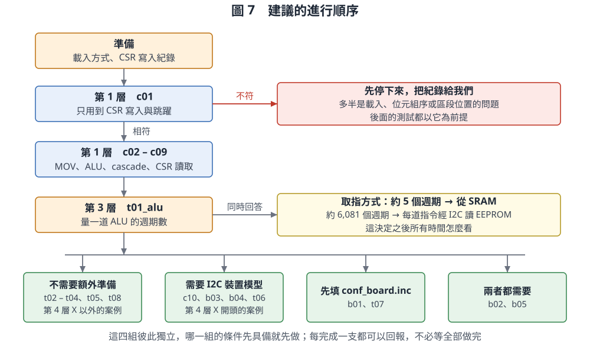

圖 7 的幾個決定點：

- **`c01` 不符就先停**。問題多半在載入方式、位元組序或區段位置，這些會影響所有測試，先解決它最省時間。
- **第 1 層的 `c02`–`c09` 接著做**，它們只需要 Main，不需要額外的準備。
- **第 3 層的 `t01_alu` 提早做**。它只量一個數字，但那個數字同時回答了「硬體從哪裡取指」，
  這會決定之後所有時間數字怎麼解讀。
- 其餘的測試依準備條件分成四組，彼此獨立，哪一組的條件先具備就先做。

---

## 8. 第 1 層：編碼（c01–c10）

**問題**：工具產生的位元組，硬體解出來是不是同一道指令？

**詳細的預期值在 `EXPECTED.md`。** 每支測試一節，內容和第 6.3、6.4 節的格式相同。

### 8.1 十支測試

| 測試 | 檢查的對象 | 額外需要 |
|---|---|---|
| `c01_csr_branch` | 指令位元組的切分、CSR 單位元組描述子、分支描述子 | 兩格需要可讀回 |
| `c02_mov_const` | MOV 描述子（區域、位移、長度）、常數池的位置、多位元組寫入的順序 | — |
| `c03_alu_arith` | ADD／SUB／MUL／INC／DEC 的編碼數值 | — |
| `c04_alu_cmp` | 四種比較的編碼數值、有號與無號、依比較結果分支 | — |
| `c05_alu_logic` | AND／OR／XOR／NOT 的編碼數值 | — |
| `c06_alu_shift` | 移位方向的位元（0 是左移還是右移）、位數欄位 | — |
| `c07_alu_status` | 狀態位元組裡哪一個位元是哪一個旗標 | — |
| `c08_cascade` | CASCADE_BEGIN／END：選擇值 k 會執行區塊 0 到 k | — |
| `c09_csr_read` | CSR 讀取、多位元組描述子、從讀取緩衝區 MOV | 可讀回 |
| `c10_peri_xfer_pub` | Peri：裝置表、I2C 傳輸描述子、發佈結果、Main 取用 | I2C 裝置 `0x2A` |

`c03`–`c07` 是最可能出現差異的：規格書沒有給 ALU 各運算的編碼數值，工具裡是照文件列出的順序編的。

### 8.2 做法

1. 載入映像，執行到 `0x67F` 被寫入 `0xA5`。
2. 每個結果位址取最後的內容，和 `EXPECTED.md`（或同名的 `*.expected.csv`）比對。
3. 標示「不可被寫入」的位址不應出現。

### 8.3 運算元是特意挑的

ALU 的測試用的數字經過挑選，讓每一種運算得到不同的結果。所以不一樣的時候，**從看到的值就能知道硬體實際做了什麼**。

以 `c03_alu_arith` 為例，運算元是 7 和 3：

| 運算 | 7 與 3 的結果 |
|---|---|
| ADD | 10 |
| SUB | 4 |
| MUL | 21 |
| INC（7 加 1） | 8 |
| DEC（7 減 1） | 6 |

如果「SUB 那一格」出現的是 21，就表示硬體把我們用來代表 SUB 的編碼當成 MUL。
你們只要回報「哪一格看到什麼值」，對應關係由我們整理。

### 8.4 「取決於」欄

`EXPECTED.md` 的表格最後一欄是「取決於」。那一欄有內容的列，代表這個預期值建立在某個前提或暫定的假設上，例如：

- 「結果 CSR 必須是寫什麼讀回什麼的一般暫存器」——前提不成立時這一格不算數。
- 編碼數值、位元位置是假設——這種格子和硬體不同是有可能的，也正是要找出來的。

「取決於」欄空白的格子和預期不同，請優先告訴我們：那代表更基本的地方有差異。

---

## 9. 第 2 層：行為（b01–b05）

**問題**：同一支程式，硬體做事的順序和模擬器一樣嗎？

**詳細的預期在 `EXPECTED.md` 的「第 2 層」。**

### 9.1 五支測試

| 測試 | 檢查的對象 | 需要 |
|---|---|---|
| `b01_timers` | Main 與 Peri 的計時器是兩顆還是一顆 | `conf_board.inc` |
| `b02_poll_ready` | Peri 輪詢狀態暫存器直到 ready，再讀資料 | `conf_board.inc`、I2C `0x2B` |
| `b03_slot_overrun` | Main 取用之前 Peri 發佈了兩次：保留哪一筆 | I2C `0x2C` |
| `b04_nack_error` | 沒有裝置回應時 Peri 的 error 旗標 | I2C 匯流排，`0x2D` 不可有裝置 |
| `b05_done_error` | Peri 回報成功與失敗，Main 依此分支 | `conf_board.inc`、I2C `0x2B`、`0x2D` 空 |

`b03` 與 `b04` 不需要板子的 CSR，可以先做。

### 9.2 除了值，還要看兩件事

**寫入的先後順序。** `EXPECTED.md` 每支測試有一張「先／後」表，例如 `b01`：

| 先 | 後 | 原因 |
|---|---|---|
| `RES+0` | `RES+1` | Main 的兩次短計時依序完成 |
| `RES+1` | `RES+8` | Peri 的長計時不受 Main 影響 |
| `RES+8` | 完成標記 | Main 之後又等了三次長計時 |

比較的是每個位址**第一次**被寫入的時刻。**只比先後，不比隔了多久**，所以不需要準確的週期數。

**I2C 匯流排上的交易。** 例如 `b03` 應該依序看到：

| 方向 | 裝置位址 | 暫存器 | 資料 |
|---|---|---|---|
| 讀取 | `0x2C` | `0x01` | 1 個位元組，裝置回 `0xA1` |
| 讀取 | `0x2C` | `0x02` | 1 個位元組，裝置回 `0xA2` |

請核對交易的數量、順序、位址、方向與資料。多出來或少掉的交易都請記下來。

### 9.3 b01：計時器是兩顆還是一顆

這一支值得多說明，因為它回答一個架構上的問題。

我們的規格定義是 Main 與 Peri **各有一顆獨立的計時器**（`docs\TIMERS.md`）。`b01` 用三次寫入的先後來確認：

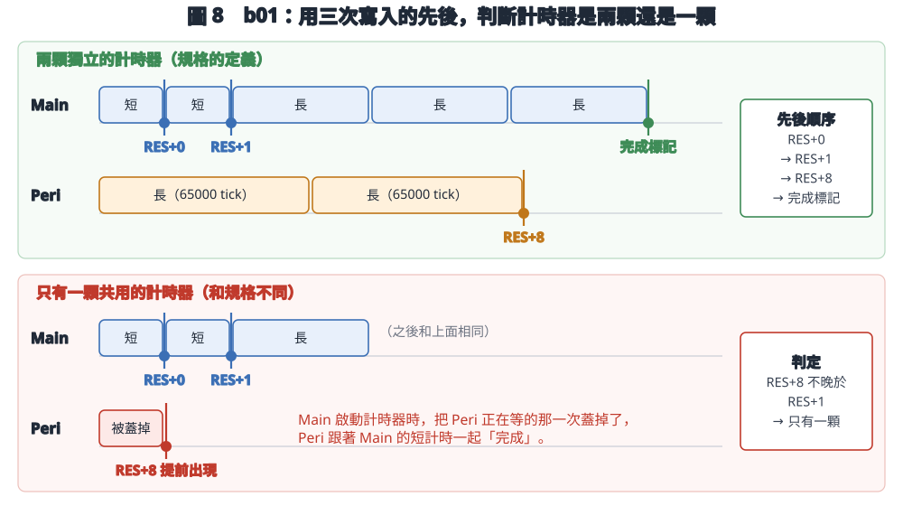

程式的安排：Main 連續做兩次短計時（各 2000 tick），各寫一個記號（`RES+0`、`RES+1`）；
同時 Peri 做兩次長計時（各 65000 tick），結束後寫 `RES+8`。

- **兩顆獨立**：Peri 的長計時不受影響，`RES+8` 在 `RES+0`、`RES+1` 之後很久才出現。
- **只有一顆**：Main 啟動計時器時蓋掉了 Peri 正在等的那一次，`RES+8` 提前到和 `RES+0`、`RES+1` 差不多的時刻。

所以判定只看一件事：**`RES+8` 是否晚於 `RES+1`**。如果你們的設計確實只有一顆計時器，請告訴我們，
那表示規格的定義要和你們討論，而不是測試失敗。

---

## 10. 第 3 層：時間（t01–t08）

**問題**：每道指令花幾個週期？

**這一層沒有對錯。** 模擬器裡的週期數本來就是等你們提供的，所以這一層是量測，不是檢查。

**詳細的量測項目與預測值在 `TIMING.md`。**

### 10.1 量測的方法

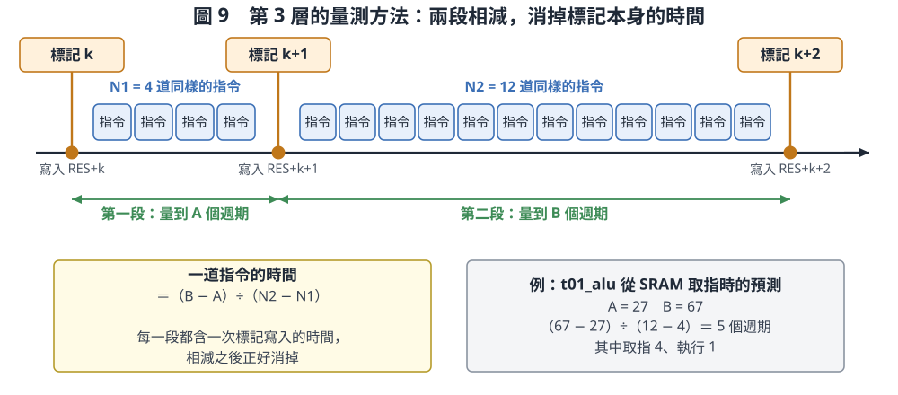

每個量測項目由三個標記（對結果 CSR 的寫入）夾出兩段：第一段放 N1 道同樣的指令，第二段放 N2 道。

```
一道指令的時間 = （第二段的週期數 − 第一段的週期數） ÷ （N2 − N1）
```

為什麼要兩段相減：每一段都包含一次標記寫入本身的時間，而我們不知道 CSR 寫入在指令的哪個時刻出現在匯流排上。
相減之後這部分正好消掉，所以**只要每個標記用同樣的方式觀察就可以**，不必關心觀察點在指令的哪個階段。

### 10.2 你們要做的

只要量「兩次 CSR 寫入之間隔了幾個 ISA 週期」。相減與除法由工具做。

範本是 `timing_measured_template.csv`，每列是一段：

```
test,from_marker,to_marker,cycles
t01_alu,0,1,
t01_alu,1,2,
t01_alu,3,4,
t01_alu,4,5,
```

- `from_marker`、`to_marker` 是標記的編號：標記 k 就是對 `RES+k` 的寫入。第一列是「`RES+0` 到 `RES+1`」。
- 把量到的週期數填在 `cycles`。量不到的列留空。

填好之後把檔案給我們。想自己先看結果也可以：

```
python make_timing.py --bin-dir .. --measured 你們的檔.csv
```

報告會把量到的值和模型的預測並排，指出最接近哪一種取指方式、該改哪個參數。

### 10.3 八支測試

| 測試 | 量什麼 | 需要 |
|---|---|---|
| `t01_alu` | 一般的 ALU 運算、乘法 | — |
| `t02_mov` | MOV 1 個與 8 個位元組 | — |
| `t03_branch` | 分支不成立與成立 | — |
| `t04_csr` | EXEC_CSR 的各種形式 | 可讀回 |
| `t05_peri` | Peri 的 CSR、分支、發佈 | — |
| `t06_xfer` | I2C 交易 | I2C `0x2E` |
| `t07_timers` | 計時器一個 tick 是幾個週期 | `conf_board.inc` |
| `t08_csr_contended` | Peri 不停寫 CSR 時，Main 的 CSR 寫入多等多久 | — |

### 10.4 先跑 t01_alu

一道指令的時間＝**取指**＋**執行**。取指的時間取決於硬體從哪裡取指，兩種情形相差一千倍以上：

| 取指方式 | 模型預測一道 ALU 指令的時間 |
|---|---|
| 從程式 SRAM（規格 v31 的寫法） | 約 5 個週期 |
| 每道指令經 I2C 從 EEPROM 讀出 | 約 6,081 個週期 |

`t01_alu` 量到的數字是哪一個數量級，就回答了取指的方式。這是目前最想知道的一件事，
而且只需要量兩段（範本的前兩列）。

### 10.5 TIMING.md 怎麼讀

每個項目列出三欄預測，對應三種情形：

| 欄 | 意思 |
|---|---|
| `eeprom` | 每道指令從 I2C EEPROM 取指 |
| `frontend` | 從程式 SRAM 取指 |
| `no_fetch` | 只算執行，不算取指 |

你們量到的值減掉取指的部分，就是該填進模擬器的執行週期數。這個換算由我們做。

---

## 11. 第 4 層：錯誤偵測（f_<編號>，48 份）

**問題**：遇到不該執行的指令，硬體怎麼反應？

**每份映像的詳細內容在 `FAULTS.md`。**

### 11.1 這些映像是什麼

正常的程式不會出現不合法的指令（組譯器會擋下來），所以要測硬體的反應，只能故意做出寫壞的映像。

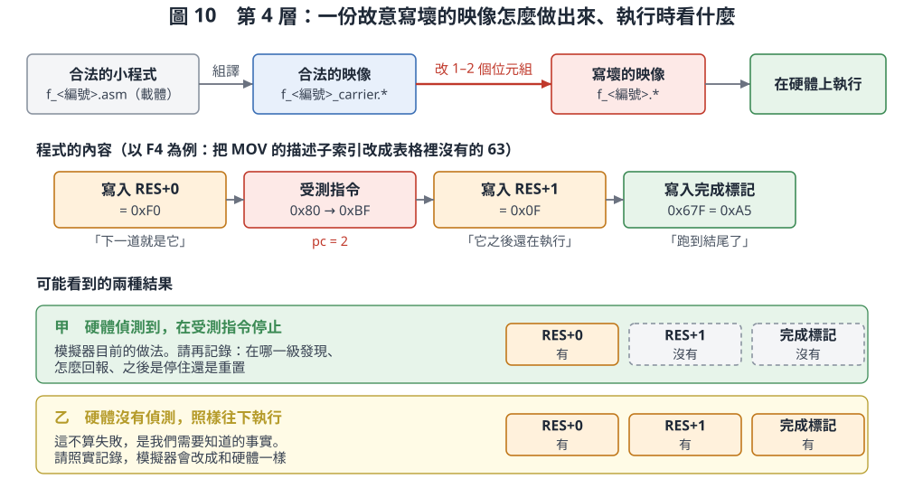

圖 10 上半是做法：先組譯一支合法的小程式（稱為載體），再改掉映像裡的一兩個位元組，
讓其中一道指令（受測指令）變成不合法。

中間是程式的內容。受測指令前後各有一個記號：

| 寫入 | 意思 |
|---|---|
| `RES+0`＝`0xF0` | 下一道就是受測指令 |
| `RES+1`＝`0x0F` | 受測指令之後的程式繼續執行了 |
| `0x67F`＝`0xA5` | 程式跑到結尾 |

### 11.2 兩種結果都是答案

圖 10 下半是可能看到的兩種情形：

- **甲**：硬體偵測到，在受測指令停止。只有 `RES+0` 出現。這是模擬器目前的做法。
- **乙**：硬體沒有偵測，照樣往下執行。三個記號都出現。

**乙不算失敗。** 硬體不檢查某一種情形是完全合理的設計選擇。我們需要知道的是事實：
知道硬體不檢查，模擬器就改成不檢查；知道硬體檢查，就確認錯誤回報的方式一致。

所以 `FAULTS.md` 裡「模型的反應」只是對照用，**不是標準答案**。

### 11.3 編號的意思

編號和 `docs\HW_FAULT_DETECTION.md` 那張表相同。字首代表類別：

| 字首 | 類別 | 納入的案例 |
|---|---|---|
| F | 共通（PC 超出程式、描述子索引超出表格） | F3、F4 |
| M | Main 的 EXEC_CSR | M1–M4 |
| B | Main 的分支 | B1–B11 |
| V | Main 的 MOV | V1–V5、V7–V10 |
| L | Main 的 ALU | L1–L5 |
| E | 事件 | E1 |
| P | Peri 的 EXEC_CSR | P1–P3 |
| R | Peri 的分支 | R1–R4 |
| U | Peri 的發佈 | U1–U3 |
| X | Peri 的 I2C 傳輸 | X1–X6 |

X 開頭的六個案例需要 I2C 裝置 `0x2F`；其餘 42 個不需要任何 I2C 裝置。

### 11.4 每個案例要記錄什麼

範本是 `faults_result_template.csv`，每列一個案例。前四欄已經填好（編號、檢查的內容、模型的錯誤碼、模型停止的 PC），
請填後面幾欄：

| 欄 | 填什麼 |
|---|---|
| `hw_RES0_written` | `RES+0` 有沒有出現（有／沒有） |
| `hw_RES1_written` | `RES+1` 有沒有出現 |
| `hw_DONE_written` | 完成標記有沒有出現 |
| `hw_fault_reported` | 硬體有沒有回報錯誤；有的話是哪個信號或狀態位元 |
| `hw_stage` | 在哪一級發現：解碼、執行、PC 更新、CSR 或 I2C 後端、載入時 |
| `hw_after` | 之後 sequencer 是停住、繼續執行、還是重置 |
| `notes` | 其他觀察 |

如果 `RES+0` 都沒有出現，表示問題在受測指令之前（例如載入時就被擋下），這也請照實記錄。

### 11.5 每個案例資料夾裡的檔案

| 檔案 | 內容 |
|---|---|
| `f_<編號>.sram.hex`、`.main.bin`、`.eeprom.bin` | **改過的**映像（要執行的是這個） |
| `f_<編號>.*.layout.json` | 區段位置（沒有改，和載體相同） |
| `f_<編號>_carrier.*` | 沒有改動的載體，會正常跑到結尾 |

建議先跑一兩個**載體**確認測試平台沒問題（三個記號都會出現），再跑改過的映像。
載體的 `.lst` 也看得出受測指令原本是什麼。

`FAULTS.md` 的表格列出每個案例改了哪個位元組，包括它在邏輯映像的位移、EEPROM 的位址、SRAM 的第幾個字的第幾個位元組，
方便你們在波形上找到它。

### 11.6 兩點提醒

- **B6**（分支目標落在一道指令的中間）：模擬器其實不檢查這個條件，它報的錯只是把立即值當成指令去解的結果。這一項最需要硬體的實際答案。
- **沒有納入的 7 列**（F1、F2、M5、M6、V6、E2、E3）：原因列在 `FAULTS.md` 最後一節。它們需要改 layout 暫存器、需要事件來源、或取決於板子的選項。
  如果你們有辦法測，請告訴我們結果。

---

## 12. 回報

### 12.1 要給我們的東西

| 層 | 內容 |
|---|---|
| 1、2 | 和預期不同的格子：測試名、位址、看到的值；或實際的先後順序、實際的 I2C 交易。全部相符也請說一聲 |
| 3 | 填好的 `timing_measured_template.csv` |
| 4 | 填好的 `faults_result_template.csv` |
| 共通 | 你們改過的 `conf_board.inc`；使用的載入方式（第 5 章的甲、乙、丙） |

**最省事的做法是把 CSR 寫入的原始記錄整份給我們**（每支測試一個檔案），比對由我們做。

一個簡短的回報範例：

```
c01 全部相符。
c03：RES+1 看到 0x15（預期 0x04），RES+2 看到 0x04（預期 0x15），其餘相符。
c06：RES+0 – RES+3 全部不符，記錄檔附上。
載入方式：甲（直接設定 SRAM 初始值），layout 由測試平台強制設定。
```

### 12.2 五個不需要跑測試就能回答的問題

這些問題的答案會影響我們怎麼解讀所有結果，請優先回覆：

1. **程式怎麼進到硬體？** 規格 v31 寫的是開機時由 Boot 模組把外部 ROM 載入一顆共用的 SRAM。
   你們的 RTL 是這樣嗎？外部 ROM 是什麼元件、用什麼介面讀？
2. **執行時從哪裡取指？** 從 SRAM，還是每道指令都經 I2C 去讀 EEPROM？
   （我們先前聽到的是後者，但規格寫的是前者。）
3. **區段位置怎麼給硬體？** 12 個位移是寫進暫存器嗎？每個幾位元？由誰寫？
4. **硬體事件怎麼產生？** 有幾項測試因為不知道事件來源而沒有做。
5. **測試平台能以 ISA 週期為單位看到 CSR 寫入的時刻嗎？** 這決定第 3 層量得多準。

### 12.3 還沒有測試的部分

下列項目目前沒有對應的測試。如果你們有現成的方法或資料，請告訴我們：

- 硬體事件：事件向量、從事件返回、事件派送的延遲
- 影像時序：VBLANK／HBLANK、可以提交的時段、畫面結束
- 兩個 sequencer 同時要用共用資源時誰先：CSR 仲裁器、狀態旗標、SRAM 讀取埠
- 第 4 層沒有納入的 7 列

---

## 13. 遇到狀況時

### 13.1 常見的現象

| 現象 | 先檢查 |
|---|---|
| 完全沒有 CSR 寫入 | 映像是否載入；sequencer 是否解除重置；六個區段位置是否送進硬體 |
| 位址或值都很亂，`c01` 就不對 | 描述子的位元組序；區段位置和映像是否同一支測試的 |
| 跑不到 `0x67F` | 記下最後一次 CSR 寫入與 sequencer 停住的 PC，對照 `.lst` 看停在哪一道指令 |
| `c01` 只有 `RES+1`、`RES+2` 不對 | 結果 CSR 不能讀回（第 4.2 節）；不是真正的問題 |
| `b01`、`b02`、`b05`、`t07` 沒有反應 | `conf_board.inc` 的位址或位元和板子不符（第 4.5 節） |
| Peri 的測試沒有任何 Peri 的寫入 | Peri 的映像在 SRAM 字 `0x0200` 起；Peri 的六個區段位置是否設定 |
| I2C 交易的資料不符 | 裝置模型的回應（第 4.3 節）；暫存器位址是 1 個位元組 |
| 第 4 層連載體都跑不完 | 測試平台的問題，先用 `c01` 確認 |

### 13.2 用清單檔找問題

每支測試的 `.lst` 是最有用的除錯資料。它列出我們認為每個位元組是什麼：

- 前半是指令：PC、位元組、指令的文字。
- 後半是每張描述子表：位置、每一筆的原始值、解讀後的意思。
- 最後是區段位置，以及映像放在 SRAM 的哪幾個字。

sequencer 停在某個 PC 時，在 `.lst` 找到那個 PC 就知道是哪一道指令。
硬體讀到的描述子值如果和 `.lst` 列的不同，問題在載入或位置；相同但行為不同，問題在欄位的解讀。

### 13.3 用工具檢查

| 想做的事 | 指令 |
|---|---|
| 把一份映像轉回文字 | `asmdis.exe`（反組譯器） |
| 在電腦上執行一支測試，列出每次 CSR 存取 | `asmsim.exe … --events ev.csv`（見第 6.5 節） |
| 改了位址之後重新產生全部映像 | 第 4.4 節的三行指令 |

---

## 14. 名詞與文件

### 14.1 名詞

| 名詞 | 意思 |
|---|---|
| 映像 | 組譯器的輸出：程式碼加上各張描述子表的位元組 |
| 邏輯映像 | 一個 sequencer 的映像，位移從 0 起算 |
| 區段位置（layout） | 六個位移，說明映像裡各張表從哪裡開始；不在映像裡 |
| 描述子 | 表裡的一筆資料，描述一道指令的細節（CSR 位址、分支目標…） |
| 結果 CSR | `0x600`–`0x67F`，測試把答案寫在這裡 |
| 完成標記 | 對 `0x67F` 寫入 `0xA5`，表示測試跑到結尾 |
| 標記 | 第 3 層裡，一次對結果 CSR 的寫入，用來標出時間點 |
| 載體 | 第 4 層裡，被改動之前的合法程式 |
| 受測指令 | 第 4 層裡，被改成不合法的那一道指令 |
| 模型 | 模擬器；它的行為是我們目前的理解，不是標準 |
| ISA 週期 | sequencer 的時脈週期 |

### 14.2 其他文件

| 想知道 | 看 |
|---|---|
| 第 1、2 層每個位址的預期值與判讀 | `EXPECTED.md` |
| 第 3 層每個量測項目的標記與預測值 | `TIMING.md` |
| 第 4 層每份映像改了哪個位元組 | `FAULTS.md` |
| 整套測試的設計與自我檢查 | `README.md` |
| 計時器的規格定義 | `..\docs\TIMERS.md` |
| 錯誤偵測的完整 55 列 | `..\docs\HW_FAULT_DETECTION.md` |
| 模擬器逐項怎麼做、哪些是假設 | `..\docs\SIM_VS_SPEC.md` |

### 14.3 這些測試本身驗證過什麼

- 每一支程式、每一份映像，都在我們的模擬器上跑過並符合文件所列的預期。這是自動測試的一部分，每次建置都會重跑。
- 第 1 層的預期值是依規格書的文字另外算的，不是抄模擬器的輸出。
- 做過反向驗證：讓解碼端故意用另一組編碼、或模擬只有一顆共用計時器，確認對應的測試會失敗。
- 三種映像格式（邏輯映像、EEPROM、SRAM 字）核對過逐位元組一致。
- 產生器在 Windows 的 Python 3 上直接執行過，產生的映像與 Linux 上的相同。

**但沒有任何一支在 RTL 或實體硬體上跑過。** 測試程式或這份文件本身若有錯，請直接告訴我們。
